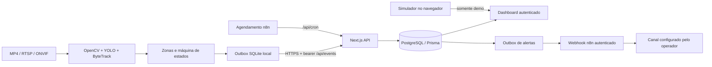

# Arquitetura e fronteiras do MVP

## Isolamento

`APP_MODE=demo` é um ambiente de apresentação, aberto, com fixtures e eventos locais. Não acessa o banco nem aceita ingestão real. `APP_MODE=production` exige sessão para leitura/ações do painel e uma chave separada para o Edge. A unidade é determinada pelo servidor, nunca por um `restaurantId` arbitrário enviado pelo navegador. Não há painel administrativo multitenant nesta versão.

O banco armazena somente metadados: mesas, configuração das zonas, eventos e fila. Vídeo e credenciais de câmera ficam no equipamento do cliente. Não há embeddings faciais nem identificação de pessoas.

## Estados

`FREE → WAITING → SERVED → CLEANING → FREE`.

Também é válida saída de `WAITING → CLEANING` sem atendimento. Uma nova ocupação não reinicia visita atendida. Eventos anteriores ao `updatedAt` não sobrescrevem o estado. Eventos são deduplicados por UUID; escrita de evento e projeção da mesa usam transação e lock de linha. Relógios do Edge devem estar sincronizados (NTP); a API rejeita mais de 60 segundos no futuro. Limpeza permanece manual para evitar inferir limpeza por mera ausência.

A atribuição de funcionários exige modelo customizado; passagem breve não conta. A regra de permanência é uma aproximação e precisa de teste. O modelo genérico não distingue clientes de equipe. O código usa centro do bounding box dentro de uma zona: área de circulação não deve se sobrepor à zona de mesa.

## Reconciliação Edge/painel

O estado Edge é persistido em `edge/outbox/state.json`, com envio posterior via SQLite. O painel pode confirmar atendimento e limpeza independentemente. A cada 5 segundos, após drenar todos os eventos locais pendentes, o Edge consulta `/api/edge/state` e reconcilia estados com o servidor. Assim, uma limpeza manual libera a próxima visita no Edge; um atendimento manual também encerra o alerta local. Enquanto houver eventos não reconhecidos, a sincronização não substitui a projeção local. O arquivo local é salvo a cada frame; ele e a outbox não compartilham uma transação, portanto desligamento abrupto nesse intervalo ainda exige supervisão. O Edge não deduplica pessoas entre câmeras.

## Alertas e resiliência

O cron calcula espera e cria outbox com ID `wait-<table>-<occupiedAt>`. A fila e o receptor n8n são separados do pipeline de vídeo. Eventos de saída/atendimento encerram a condição visual de alerta. Alertas já enfileirados podem ficar obsoletos antes de envio; o consumidor deve consultar/verificar estado atual ou a plataforma deve descartar os itens resolvidos (implementado no dreno). Entrega tem semântica ao menos uma vez; canal precisa deduplicar por ID. Falhas após aceite HTTP podem gerar nova tentativa. Após 10 tentativas o registro permanece para intervenção (Prisma Studio); não é apagado silenciosamente.

`lastSeen` de câmera está reservado no schema, mas heartbeat de câmera e métricas de saúde não estão conectados. A interface exibe cadastro, nunca afirma que uma câmera real está online sem evidência.

## Agente

Copiloto determinístico, sem LLM externo e sem executar ações autônomas. Na demo inclui análise do fluxo simulado. Em produção resume ocupação e alertas reais; não interpreta perguntas livres com um modelo. O endpoint `/api/agent` permite evoluir para um provedor sem expor banco ou segredos ao cliente.

## Próximos incrementos

Contador de porta por linha, agregados históricos por fuso horário da unidade, heartbeat de câmeras, cadastro persistido de mesas via interface, organizações/usuários/RBAC, auditoria e limitação de tentativas de login. Previsões só após conjunto de dados real suficiente e avaliação de erro.
